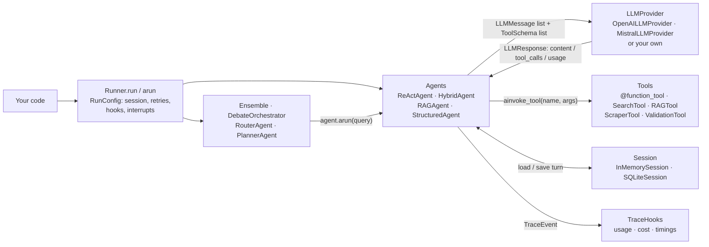
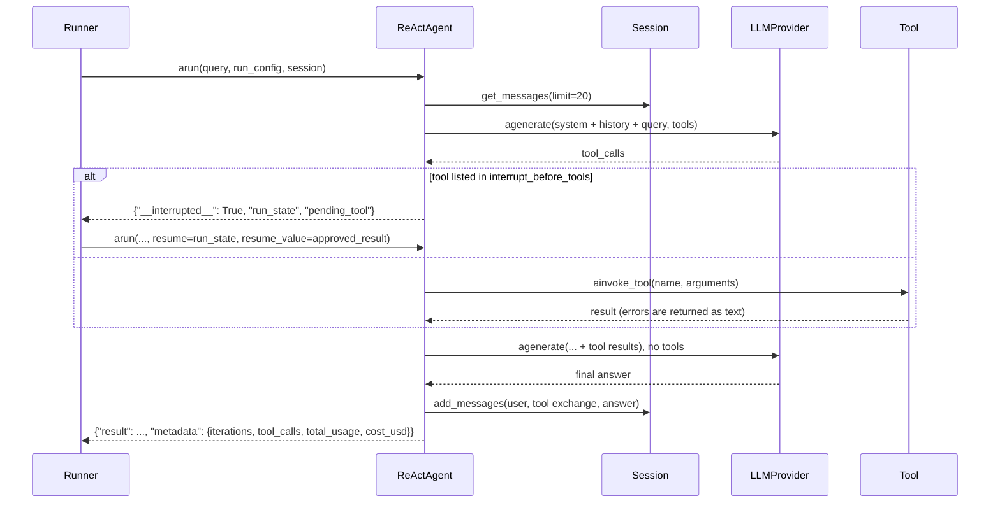
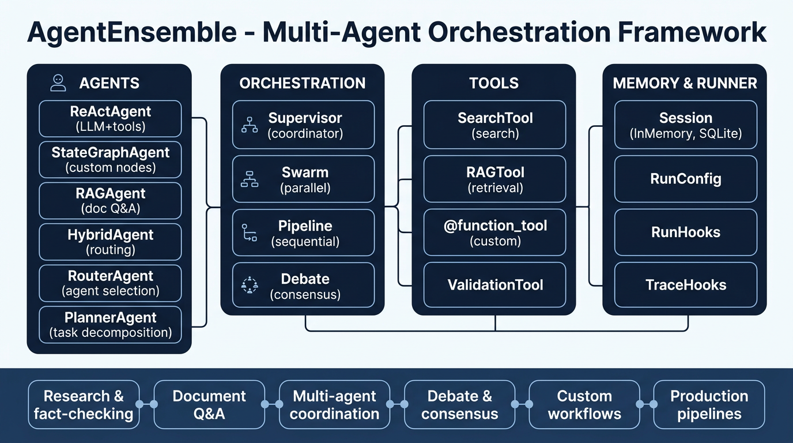

<div align="center">

# AgentEnsemble

**Build, orchestrate, trace, and test multi-agent LLM systems in Python, with OpenAI or Mistral.**

[](https://pypi.org/project/agentensemble/)
[](https://pypi.org/project/agentensemble/)
[](https://pepy.tech/projects/agentensemble)
[](https://github.com/irfanalidv/AgentEnsemble/actions/workflows/tests.yml)
[](https://github.com/irfanalidv/AgentEnsemble/actions/workflows/codeql.yml)
[](https://github.com/irfanalidv/AgentEnsemble/blob/main/LICENSE)
[](https://github.com/astral-sh/ruff)
[](https://mypy-lang.org/)
[](https://github.com/irfanalidv/AgentEnsemble/blob/main/CONTRIBUTING.md)

</div>

## Why AgentEnsemble

Most agent projects need the same handful of pieces: a tool-calling loop, a way to combine
several agents, memory between turns, a pause before risky actions, and visibility into tokens
and cost. AgentEnsemble gives you those pieces as small, plain-Python classes behind one
`run()` / `arun()` interface, so you can start with one agent and grow into routers, pipelines,
swarms and debates without changing how you call them. LangChain is used only inside the LLM
providers; agents, tools and results are your own objects and plain dicts.

## Features

| Area | What you get |
| --- | --- |
| **Agents** | `ReActAgent` (native tool calling), `HybridAgent` (search → RAG → validate), `RAGAgent`, `StructuredAgent` (Pydantic output), `StateGraphAgent`, `RouterAgent`, `PlannerAgent` |
| **Orchestration** | `Ensemble` with supervisor / swarm (parallel) / pipeline modes, `DebateOrchestrator`, `WorkflowGraph` with conditional edges |
| **Tools** | `@function_tool` (JSON schema from type hints), `SearchTool` (Serper or DuckDuckGo), `RAGTool` (URLs or local text), `ScraperTool` (httpx or Playwright), `ValidationTool`, `ToolRegistry` |
| **LLM providers** | OpenAI and Mistral built in, picked from the environment (OpenAI first); any `LLMProvider` subclass works |
| **Runtime** | `Runner` + `RunConfig`: sessions (`InMemorySession`, `SQLiteSession`), retries, lifecycle hooks, human-in-the-loop interrupts |
| **Observability** | `TraceHooks` events for runs, LLM calls and tools, token usage, cost estimates, `astream()` events for UIs |
| **Evaluation** | `AgentComparison`, `Benchmark`, `Metrics` to compare agents on the same tasks |
| **Quality** | Typed (`py.typed`, mypy-clean), tested with fake LLMs (no network in CI), Python 3.10 to 3.13 |

## Install

```bash
pip install agentensemble            # or: uv add agentensemble
```

| Extra | Adds | Install |
| --- | --- | --- |
| `search` | DuckDuckGo (`ddgs`) and Serper backends for `SearchTool` | `pip install "agentensemble[search]"` |
| `rag` | Chroma, sentence-transformers, text splitters, BeautifulSoup for `RAGTool` | `pip install "agentensemble[rag]"` |
| `observability` | LangSmith and OpenTelemetry API | `pip install "agentensemble[observability]"` |
| `all` | All of the above | `pip install "agentensemble[all]"` |

## Quickstart

Needs `OPENAI_API_KEY` (or `MISTRAL_API_KEY`) in the environment or a `.env` file.

```python
from agentensemble import ReActAgent, function_tool


@function_tool(description="Look up the shipping status of an order by id")
def order_status(order_id: str) -> str:
    return {"A100": "shipped", "B200": "processing"}.get(order_id, "not found")


agent = ReActAgent(tools=[order_status])  # OpenAI if OPENAI_API_KEY is set, else Mistral
result = agent.run("Has order A100 shipped yet?")
print(result["result"])
print(result["metadata"])
```

Output from a run with `gpt-4.1-mini` (model wording varies):

```text
Yes, order A100 has shipped.
{'iterations': 1, 'tool_calls': 1, 'agent': 'react_agent', 'total_usage': {'input_tokens': 439, 'output_tokens': 24, 'total_tokens': 463}, 'cost_usd': 0.00021400000000000002}
```

No key yet? Graph workflows run without an LLM, and every script in
[`examples/`](https://github.com/irfanalidv/AgentEnsemble/tree/main/examples) marked "offline"
runs with a built-in rule-based stand-in model:

```python
from agentensemble import WorkflowGraph

graph = (
    WorkflowGraph(entry="classify")
    .add_node("classify", lambda s: {"context": {"refund": "refund" in s["query"].lower()}})
    .add_node("refund", lambda s: {"result": "Routed to the refunds team"})
    .add_node("general", lambda s: {"result": "Routed to general support"})
    .add_edge("classify", "refund", lambda s: s["context"]["refund"])
    .add_edge("classify", "general")
)
out = graph.run("I want a refund for my order")
print(out["result"], out["metadata"]["nodes_visited"])
# Routed to the refunds team ['classify', 'refund']
```

## How it works



One `ReActAgent` turn, including the optional human approval step:



**Design decisions**

- **One provider interface.** Agents only see `LLMProvider.generate` / `agenerate` and Pydantic
  message models (`agentensemble/llm/interface.py`). The OpenAI and Mistral providers share
  one LangChain adapter (`llm/langchain_base.py`); adding a provider means subclassing
  `LLMProvider` or `LangChainChatProvider`.
- **Native tool calling.** Tools are described by JSON schemas (inferred from type hints by
  `@function_tool`) and called through the model's function-calling API, not parsed from text.
- **Bounded tool use per turn.** After the first round of tool results in a turn, the model is
  asked to answer without tools. This keeps cost and latency predictable; `max_iterations`
  caps the loop as well.
- **Async first.** Every agent has `arun()`; `run()` wraps it with `asyncio.run()`. Providers
  rebuild their HTTP client when used on a new event loop, so repeated sync calls work.
- **Plain results.** Agents return `{"result": str, "metadata": dict}`. The human-in-the-loop
  `run_state` is a JSON-serialisable dict, so a paused run can be stored and resumed later.
- **Usable without keys.** LLM agents can be constructed, inspected and registered without an
  API key; `run()` raises a clear `RuntimeError` until a provider is configured.

<details>
<summary>Module map</summary>

```text
agentensemble/
├── agents/         ReActAgent, HybridAgent, RAGAgent, StateGraphAgent, StructuredAgent, BaseAgent
├── llm/            LLMProvider, OpenAILLMProvider, MistralLLMProvider, get_default_provider
├── tools/          @function_tool, SearchTool, RAGTool, ScraperTool, ValidationTool, ToolRegistry
├── orchestration/  Ensemble, Supervisor/Swarm/PipelineOrchestrator, DebateOrchestrator
├── router/         RouterAgent (LLM picks an agent via a constrained tool call)
├── planner/        PlannerAgent (rule-based decomposition; override _decompose for LLM planning)
├── graph/          WorkflowGraph, Edge
├── memory/         Session protocol, InMemorySession, SQLiteSession
├── tracing/        TraceHooks, TraceEvent, estimate_cost
├── testing/        AgentComparison, Benchmark, Metrics
├── utils/          get_chat_model, get_default_embeddings, provider helpers
└── runner.py       Runner, RunConfig, RunHooks
```

<p align="center">
  
</p>

</details>

## Use cases and examples

Runnable scripts in [`examples/`](https://github.com/irfanalidv/AgentEnsemble/tree/main/examples).
The first four run offline (no key) and switch to OpenAI or Mistral when a key is set; pass
`--offline` to force offline mode.

| Script | Use case | Needs |
| --- | --- | --- |
| [`customer_support_rag.py`](https://github.com/irfanalidv/AgentEnsemble/blob/main/examples/customer_support_rag.py) | Answer customer questions from a help-center FAQ with `RAGTool.index_texts` and `ReActAgent` | `[rag]` extra; offline |
| [`support_ticket_triage.py`](https://github.com/irfanalidv/AgentEnsemble/blob/main/examples/support_ticket_triage.py) | Route tickets with `WorkflowGraph`; a `ValidationTool` gate escalates bad refund replies | offline |
| [`order_assistant_approval.py`](https://github.com/irfanalidv/AgentEnsemble/blob/main/examples/order_assistant_approval.py) | Order bot with `SQLiteSession` memory, `TraceHooks`, and human approval before refunds | offline |
| [`sales_csv_analyst.py`](https://github.com/irfanalidv/AgentEnsemble/blob/main/examples/sales_csv_analyst.py) | Answer revenue questions over a CSV with deterministic `@function_tool` analytics | offline |
| [`graph_workflow_example.py`](https://github.com/irfanalidv/AgentEnsemble/blob/main/examples/graph_workflow_example.py), [`runner_example.py`](https://github.com/irfanalidv/AgentEnsemble/blob/main/examples/runner_example.py), [`research_agent_example.py`](https://github.com/irfanalidv/AgentEnsemble/blob/main/examples/research_agent_example.py) | Graphs, `Runner` hooks, planner → router → executor | offline |
| [`react_llm_example.py`](https://github.com/irfanalidv/AgentEnsemble/blob/main/examples/react_llm_example.py), [`swarm_example.py`](https://github.com/irfanalidv/AgentEnsemble/blob/main/examples/swarm_example.py), [`debate_example.py`](https://github.com/irfanalidv/AgentEnsemble/blob/main/examples/debate_example.py), [`streaming_example.py`](https://github.com/irfanalidv/AgentEnsemble/blob/main/examples/streaming_example.py), [`showcase_all.py`](https://github.com/irfanalidv/AgentEnsemble/blob/main/examples/showcase_all.py) | Search agents, parallel swarm, debate, streaming events, full tour | API key (+ `[search]`) |

<details>
<summary>Recipes (need <code>OPENAI_API_KEY</code> or <code>MISTRAL_API_KEY</code>)</summary>

**Human approval before a sensitive tool**

```python
from agentensemble import ReActAgent, RunConfig, Runner, function_tool


@function_tool(description="Send money to a recipient")
def execute_payment(amount: float, recipient: str) -> str:
    return f"Paid ${amount:.2f} to {recipient}"


agent = ReActAgent(tools=[execute_payment])
config = RunConfig(interrupt_before_tools=["execute_payment"])

result = Runner.run(agent, "Pay $50 to Alice", config=config)
if result.get("__interrupted__"):
    pending = result["pending_tool"]  # {'name': 'execute_payment', 'arguments': {...}}
    approved = execute_payment.run(**pending["arguments"])  # after a human says yes
    result = Runner.run(
        agent,
        "Pay $50 to Alice",
        config=config,
        resume=result["run_state"],
        resume_value=approved,
    )
print(result["result"])
```

**Multi-turn memory**

```python
from agentensemble import InMemorySession, ReActAgent, RunConfig, Runner

agent = ReActAgent(name="chatbot")
config = RunConfig(session=InMemorySession("chat-1"))  # or SQLiteSession("chat-1", db_path=...)
Runner.run(agent, "My name is Priya and I live in Lisbon.", config=config)
print(Runner.run(agent, "Which city do I live in?", config=config)["result"])  # ... Lisbon.
```

**Route to the right specialist**

```python
from agentensemble import ReActAgent, RouterAgent

router = RouterAgent(
    agents={"billing": ReActAgent(name="billing"), "tech_support": ReActAgent(name="tech_support")}
)
out = router.run("I was charged twice for my subscription this month")
print(out["metadata"]["routed_to"])  # billing
```

**Structured output**

```python
from pydantic import BaseModel, Field
from agentensemble import StructuredAgent


class ProductReview(BaseModel):
    product: str = Field(description="Product name")
    rating: int = Field(description="1-5 stars")
    summary: str = Field(description="Brief summary")


agent = StructuredAgent(response_format=ProductReview)
result = agent.run("Review: Acme X1 headphones - 4 stars, great sound, short battery life")
print(result["structured_response"])
# product='Acme X1 headphones' rating=4 summary='Great sound quality but battery life is short.'
```

**Parallel swarm and debate** (`ReActAgent(tools=[])` answers from the model alone)

```python
from agentensemble import DebateOrchestrator, ReActAgent, SwarmOrchestrator

swarm = SwarmOrchestrator(
    agents={"optimist": ReActAgent(name="optimist"), "skeptic": ReActAgent(name="skeptic")}
)
views = swarm.perform("Should a 5-person startup self-host its LLM?")

debate = DebateOrchestrator(
    solvers=[ReActAgent(name="s1"), ReActAgent(name="s2")],
    aggregator=ReActAgent(name="judge"),
    rounds=2,
)
print(debate.debate("A bat and a ball cost $1.10; the bat costs $1 more. Ball price?")["result"])
```

**Tracing, usage and cost**

```python
from agentensemble import ReActAgent, RunConfig, Runner, TraceHooks

hooks = TraceHooks(on_event=lambda e: print(e.type.value, e.duration_ms))
result = Runner.run(ReActAgent(), "Hello!", config=RunConfig(trace_hooks=hooks))
print(result["metadata"].get("total_usage"), result["metadata"].get("cost_usd"))
```

</details>

## Configuration

**Environment variables** (a `.env` file in the working directory is loaded automatically; see
[`.env.example`](https://github.com/irfanalidv/AgentEnsemble/blob/main/.env.example)):

| Variable | Purpose | Default |
| --- | --- | --- |
| `OPENAI_API_KEY` | Enables OpenAI; preferred when set | none |
| `OPENAI_MODEL` | Default model for `OpenAILLMProvider`. Reasoning models (`o*`, `gpt-5*`) run at the API's default temperature | `gpt-4.1-mini` |
| `OPENAI_BASE_URL` | OpenAI-compatible endpoint (vLLM, LM Studio, proxies) | OpenAI |
| `MISTRAL_API_KEY` | Enables Mistral; used when no OpenAI key is set | none |
| `MISTRAL_MODEL` | Default model for `MistralLLMProvider` | `mistral-large-latest` |
| `AGENTENSEMBLE_LLM_PROVIDER` | Force `openai` or `mistral` | auto |
| `SERPER_API_KEY` | `SearchTool()` uses Serper when set, else DuckDuckGo | none |

**Main options**

| Where | Option | Default | Meaning |
| --- | --- | --- | --- |
| `ReActAgent` / `HybridAgent` | `llm=` | from env | Any `LLMProvider` instance |
| | `max_iterations=` | 10 / 15 | Upper bound on loop steps |
| | `session=` | `None` | Session used when none is passed via `RunConfig` |
| `RunConfig` | `session`, `hooks`, `trace_hooks` | `None` | Memory, lifecycle callbacks, tracing |
| | `interrupt_before_tools` | `None` | Tool names that pause the run for approval |
| | `max_retries`, `retry_on` | `0`, `(Exception,)` | Retry policy for the whole run |
| `RAGTool` | `embeddings=`, `vector_store=` | env provider, in-memory | Bring your own embeddings or store |
| | `chunk_size`, `chunk_overlap`, `fetch_timeout` | 1000, 200, 30 s | Splitting and URL loading |
| `ScraperTool` | `provider`, `timeout`, `max_chars` | `"simple"`, 15 s, 20000 | httpx or Playwright fetch |
| `WorkflowGraph` | `entry`, `exit_nodes`, `max_steps` | `"start"`, `["end"]`, 50 | Graph execution limits |

## API overview

| Object | Kind | Summary |
| --- | --- | --- |
| `ReActAgent(tools, llm, session, max_iterations)` | agent | Tool-calling loop; `run`, `arun`, `astream` |
| `HybridAgent(tools, llm, early_stopping)` | agent | LLM (or fixed) routing over search / RAG / validate |
| `RAGAgent(tools, fallback_strategies)` | agent | Queries a `RAGTool`, retries with query variations |
| `StructuredAgent(response_format, model, tools)` | agent | Returns a Pydantic object in `structured_response` |
| `StateGraphAgent(nodes)` / `WorkflowGraph(nodes, edges)` | graph | Function nodes with routing and conditional edges |
| `RouterAgent(agents, llm)` | agent | Picks one agent per query; `route_only()` for `Ensemble` |
| `PlannerAgent(executor, max_subtasks)` | agent | Splits a task into subtasks and runs them |
| `Ensemble(agents, conductor, router)` | orchestration | `"supervisor"`, `"swarm"` (parallel) or `"pipeline"` |
| `DebateOrchestrator(solvers, aggregator, rounds)` | orchestration | Proposals, refinement rounds, aggregator decision |
| `Runner.run / arun(agent, input, config)` | runtime | Applies `RunConfig`: session, hooks, retries, interrupts |
| `function_tool(name, description)` | tools | Decorator turning a typed function into a tool |
| `SearchTool`, `RAGTool`, `ScraperTool`, `ValidationTool` | tools | Built-in tools |
| `InMemorySession`, `SQLiteSession` | memory | Conversation history stores |
| `TraceHooks`, `TraceEvent`, `estimate_cost` | tracing | Events, token usage, USD estimates from list prices |
| `get_default_provider()`, `OpenAILLMProvider`, `MistralLLMProvider` | llm | Provider selection and implementations |
| `AgentComparison`, `Benchmark`, `Metrics` | evaluation | Run agents on the same cases and compare |

## Research and references

- **ReAct** (`ReActAgent`): S. Yao, J. Zhao, D. Yu, N. Du, I. Shafran, K. Narasimhan, Y. Cao.
  *ReAct: Synergizing Reasoning and Acting in Language Models.* ICLR 2023. AgentEnsemble runs
  the reason / act / observe loop through native function calling instead of text parsing.
- **Multi-agent debate** (`DebateOrchestrator`): Y. Du, S. Li, A. Torralba, J. B. Tenenbaum,
  I. Mordatch. *Improving Factuality and Reasoning in Language Models through Multiagent
  Debate.* ICML 2024. Solvers see each other's answers for several rounds before an aggregator
  decides.
- **Retrieval-augmented generation** (`RAGTool`, `RAGAgent`): P. Lewis et al.
  *Retrieval-Augmented Generation for Knowledge-Intensive NLP Tasks.* NeurIPS 2020. Here the
  retriever is a LangChain vector store and the retrieved passages are handed to the agent's LLM.

## When to use it

AgentEnsemble fits when you want readable agent code with a small API, OpenAI or Mistral, and
built-in sessions, tracing and approvals, without adopting a large framework. If you need
durable, checkpointed graph execution across processes, a very large integration catalogue, or
a provider other than OpenAI-compatible endpoints and Mistral out of the box, a larger framework
such as LangGraph may suit you better; AgentEnsemble agents can still be called from it, since
they are plain Python objects.

## Roadmap

- LLM-based planning in `PlannerAgent` (today it is rule-based; `_decompose` can be overridden).
- Optional multi-round tool use per turn in `ReActAgent`.
- Token-level streaming in `astream()` (today it streams step events).
- Async-native `SQLiteSession` and a Redis session.
- Anthropic and other providers through the same `LLMProvider` interface.

## Contributing, security, citation, license

- Contributions are welcome: see [CONTRIBUTING.md](https://github.com/irfanalidv/AgentEnsemble/blob/main/CONTRIBUTING.md)
  and the [Code of Conduct](https://github.com/irfanalidv/AgentEnsemble/blob/main/CODE_OF_CONDUCT.md).
  CI runs `ruff check`, `ruff format --check`, `mypy agentensemble` and `pytest --cov` on
  Python 3.10 to 3.13.
- Report vulnerabilities as described in [SECURITY.md](https://github.com/irfanalidv/AgentEnsemble/blob/main/SECURITY.md).
- If you use AgentEnsemble in research, please cite it with
  [CITATION.cff](https://github.com/irfanalidv/AgentEnsemble/blob/main/CITATION.cff) (GitHub's
  "Cite this repository" button reads it).
- Changes are listed in the [CHANGELOG](https://github.com/irfanalidv/AgentEnsemble/blob/main/CHANGELOG.md).
- MIT licensed: see [LICENSE](https://github.com/irfanalidv/AgentEnsemble/blob/main/LICENSE).
